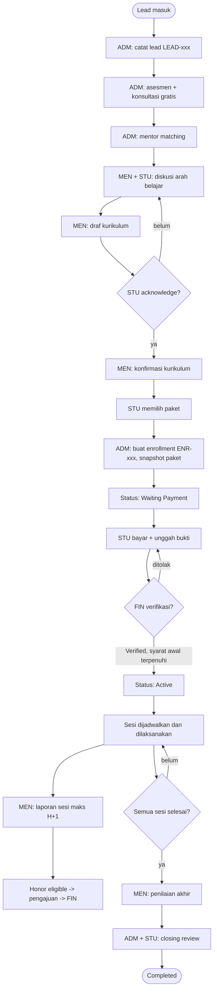
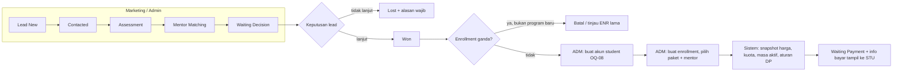
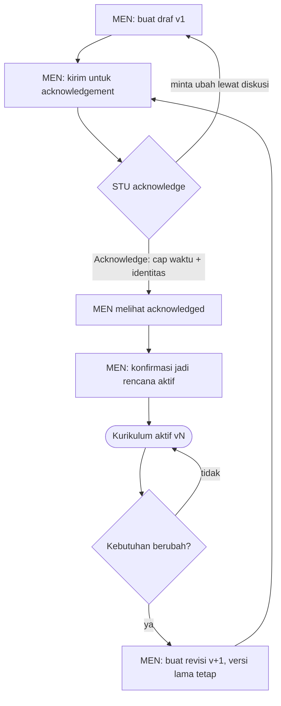
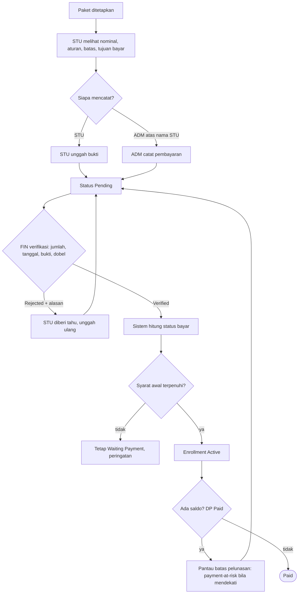
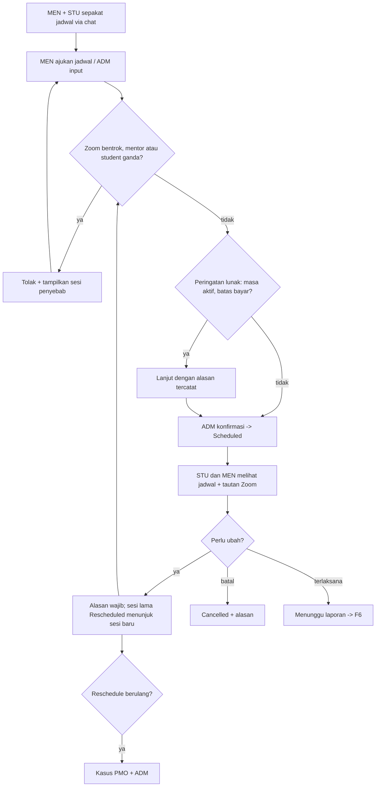
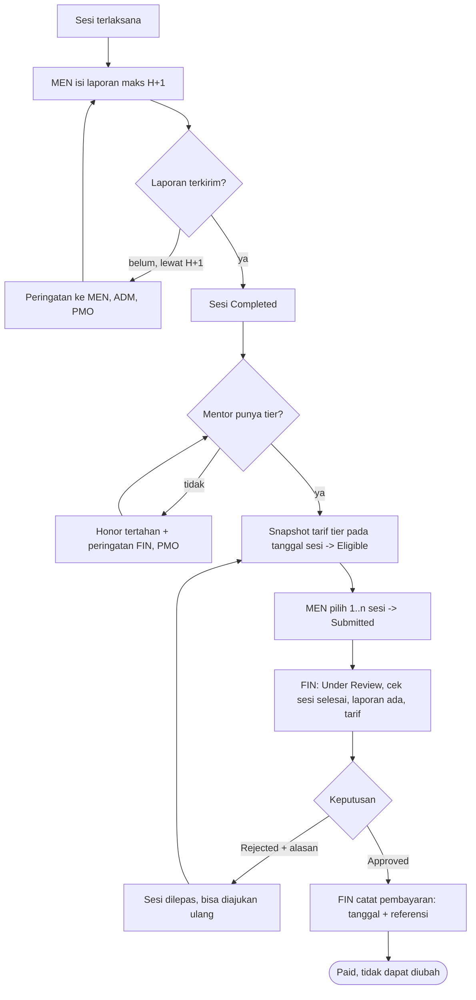
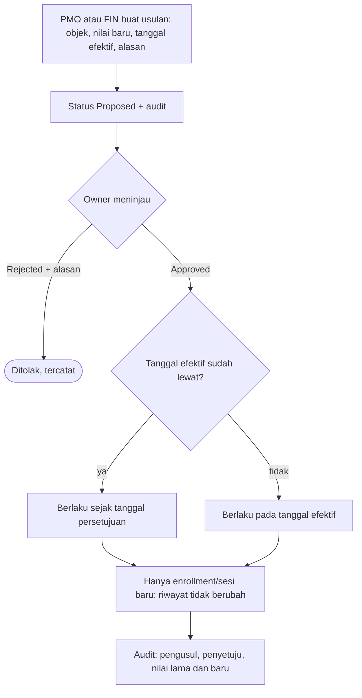
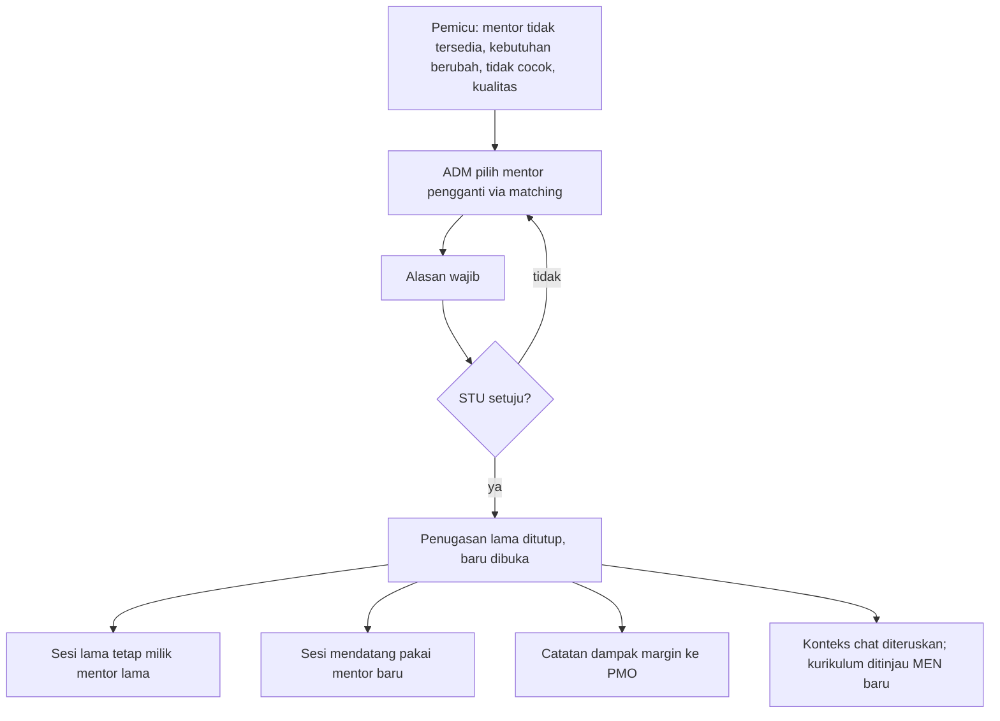
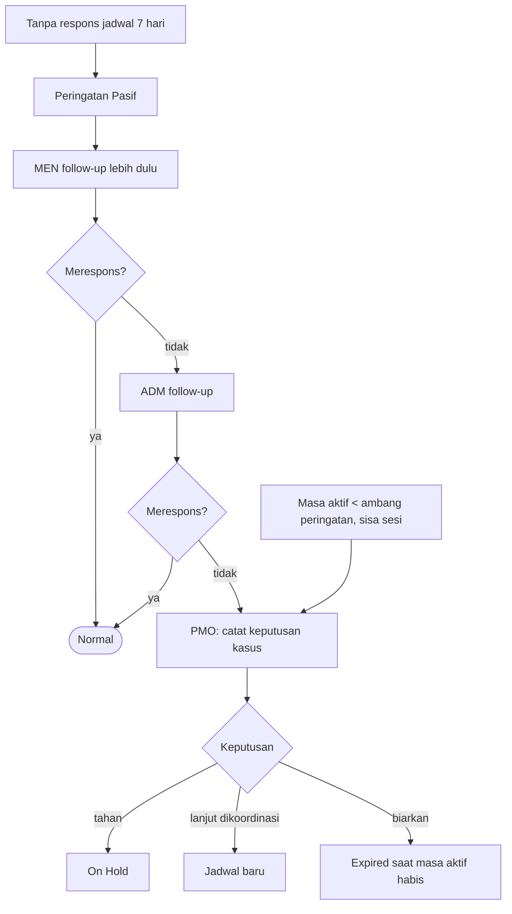
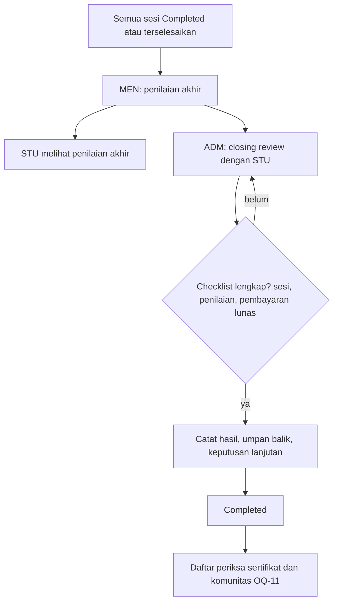

# 04. Flowchart Proses

Semua diagram memakai Mermaid (tampil di GitHub dan editor Markdown modern). Versi interaktif ada di aplikasi wireframe: menu **Blueprint**, tab Flowchart.

## F1. Siklus hidup end-to-end

## F2. Lead menjadi enrollment

## F3. Kurikulum dan revisi

## F4. Pembayaran student

## F5. Penjadwalan, reschedule, bentrok Zoom

## F6. Laporan sesi sampai honor dibayar

## F7. Perubahan konfigurasi (D-04)

## F8. Penggantian mentor

## F9. Student pasif dan masa aktif

## F10. Closing dan penyelesaian

