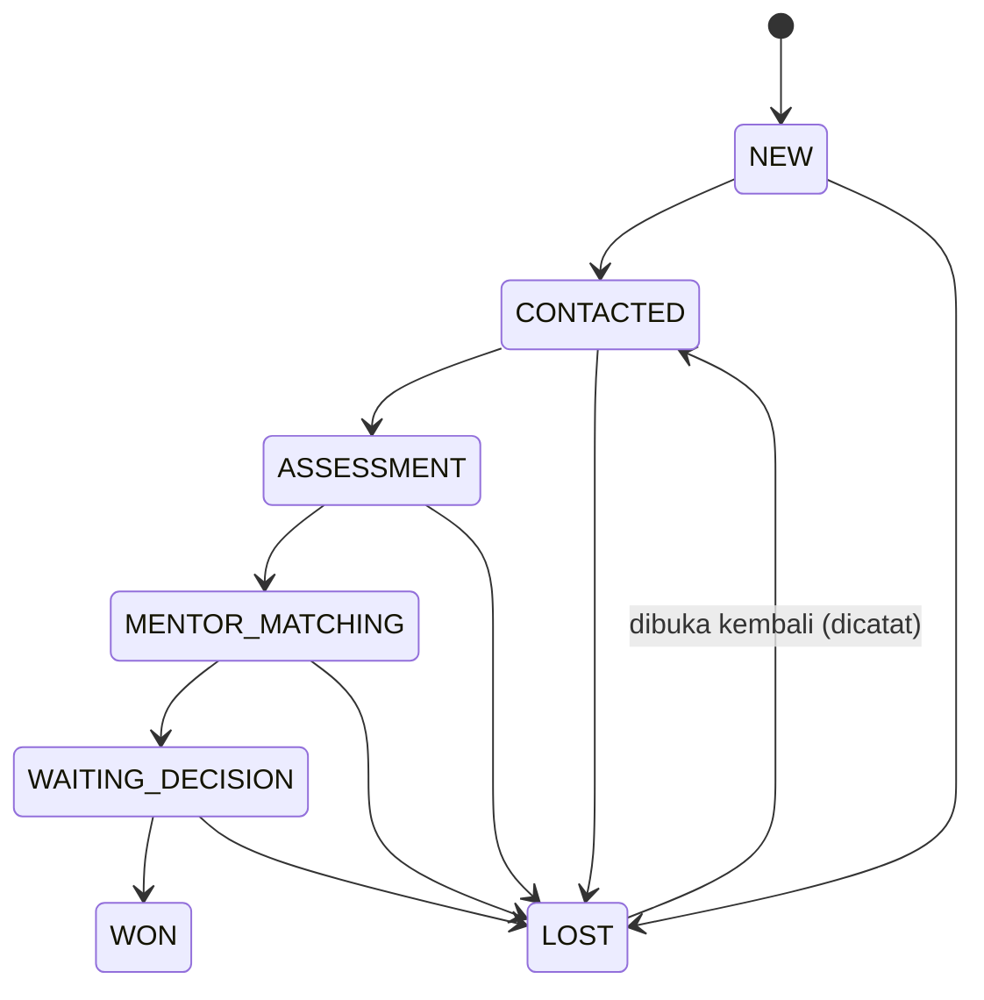
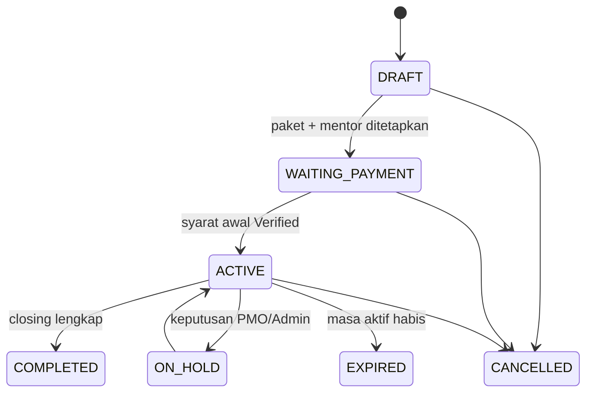
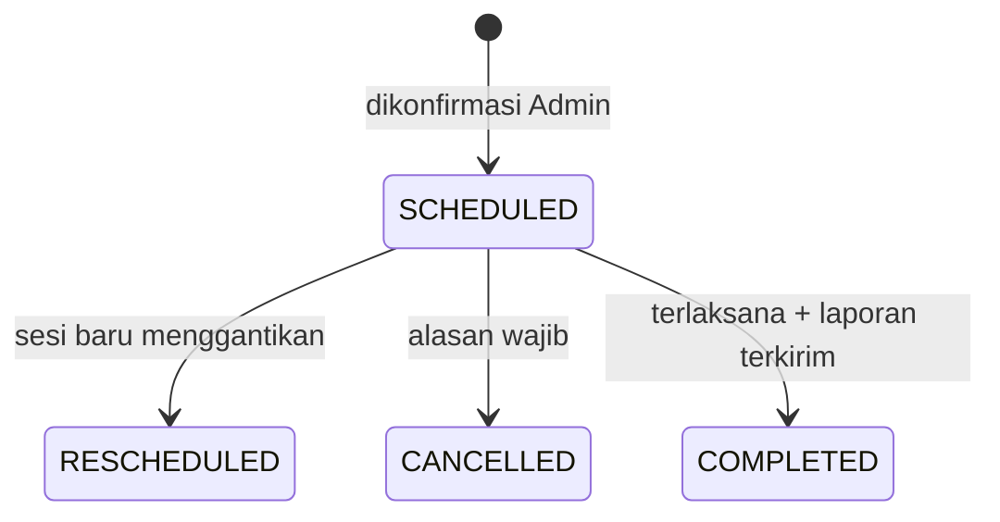
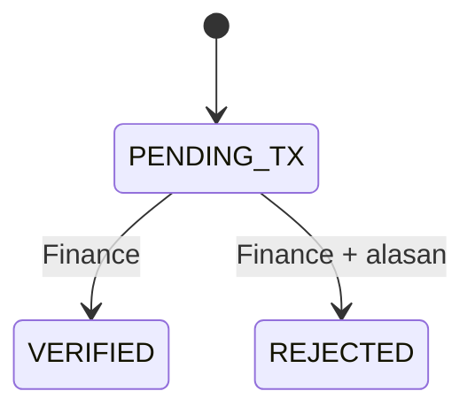
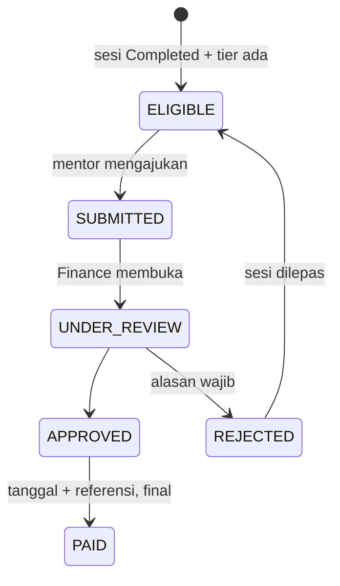
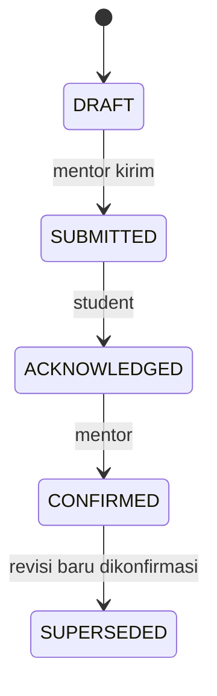
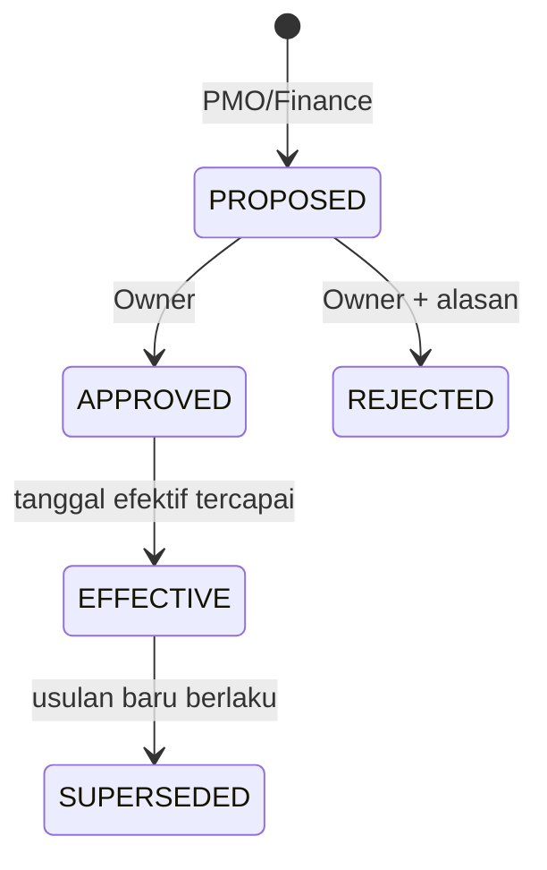

# 05. Status dan Transisi

Hanya status resmi dari Book/PRD. Kondisi turunan (Overdue, Passive, At Risk, Expiring, Conflict, Needs Confirm) adalah **penanda**, bukan status.

## Lead

Lost wajib alasan. Won membuka konversi ke enrollment. Pembukaan kembali Lost [USULAN].

## Enrollment

## Sesi

`needs_confirm` aktif saat jadwal diajukan mentor dan belum dikonfirmasi Admin. Laporan terlambat = sesi lewat H+1 tanpa laporan.

## Pembayaran (transaksi) dan status bayar enrollment

Status bayar enrollment (dihitung): `Pending` -> `DP Paid` / `Partially Paid` -> `Paid` berdasarkan total Verified terhadap harga snapshot dan aturan DP.

## Honor (CF-05, OQ-21)

## Kurikulum

## Usulan konfigurasi

## Keterkaitan status antar entitas
| Pemicu | Efek |
|---|---|
| Pembayaran Verified memenuhi syarat awal | Enrollment WAITING_PAYMENT -> ACTIVE |
| Laporan sesi terkirim | Sesi -> COMPLETED; honor ELIGIBLE (bila tier ada) |
| Semua sesi selesai + penilaian akhir | Enrollment siap closing |
| Closing lengkap | Enrollment COMPLETED |
| Masa aktif habis | Enrollment EXPIRED + kasus PMO bila ada sisa sesi |
| Lead WON | Konversi diizinkan; lead tidak dihapus |
| Usulan konfigurasi APPROVED | Berlaku untuk enrollment/sesi baru setelah tanggal efektif |
