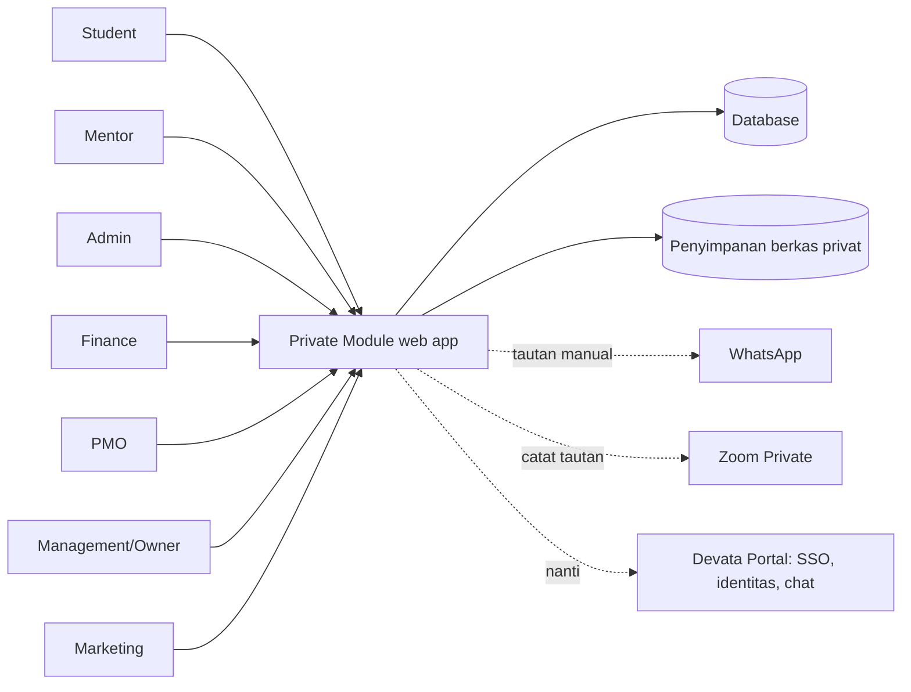
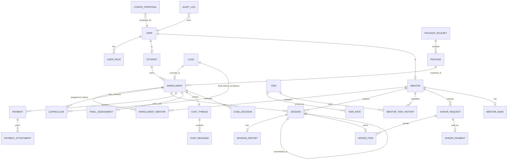

# 06. Arsitektur

Keputusan D-06: dibangun mandiri mengikuti stack Devata Portal. Stack Portal belum diverifikasi (OQ-18), jadi dokumen ini **netral stack**. Yang dikunci: batas modul, model data, aturan keamanan, dan kontrak API.

## 1. Konteks sistem

Di luar sistem: pembayaran bank (manual), Zoom (hanya tautan dan slot), WhatsApp (tautan klik manual, tidak ada pengiriman otomatis).

## 2. Gaya arsitektur
Modular monolith dengan tiga lapis:
1. **Presentation**: UI per peran, validasi ringan.
2. **Application services**: orkestrasi per modul, transaksi, otorisasi, audit.
3. **Domain (fungsi murni, tanpa I/O)**: status bayar, kelayakan aktivasi, bentrok jadwal, eligibilitas honor, snapshot tarif, perhitungan DP. Inilah aset yang dipindahkan ke Portal (NFR-INT-01).

Alasan: volume kecil (OQ-12), satu tim, kebutuhan integrasi ke Portal; microservices tidak diperlukan.

## 3. Modul dan kepemilikan data
| Modul | Entitas utama | Bergantung pada |
|---|---|---|
| Identity & Access | user, role, session | - |
| CRM | lead, lead_interaction | Identity |
| Mentor | mentor, mentor_tier_history, mentor_bank | Identity, Config |
| Curriculum | curriculum, curriculum_ack | CRM/Enrollment, Mentor |
| Enrollment | enrollment, enrollment_mentor | CRM, Mentor, Config |
| Scheduling | session, session_change | Enrollment, Mentor |
| Reporting | session_report, final_assessment | Scheduling |
| Payment | payment, payment_attachment | Enrollment, Config |
| Honor | honor_item, honor_request, honor_payment | Reporting, Mentor, Config |
| Config | config_proposal, package_ruleset, tier, tier_rate, payment_destination | Identity |
| Communication | chat_thread, chat_message | Enrollment |
| Monitoring | case_decision, alert (turunan) | semua (baca) |
| Audit | audit_log | semua (tulis) |
| Notification | notification | semua |

Aturan: modul hanya menulis tabelnya sendiri; lintas modul lewat service, bukan SQL langsung.

## 4. ERD

Kolom kunci:
- Semua entitas operasional: `code` unik tak berubah (BR-DAT-01), `created_at`, `created_by`, `archived_at`.
- `enrollment`: `package_code`, `price_snapshot`, `quota_snapshot`, `validity_months_snapshot`, `dp_rule_snapshot`, `ruleset_id_snapshot`, `status`, `start_date`, `end_date`.
- `session`: `enrollment_id`, `mentor_id` (pengajar), `is_guest`, `guest_reason`, `start_at`, `end_at`, `status`, `needs_confirm`, `zoom_link`, `replaced_by_session_id`, `change_reason`.
- `honor_item`: `session_id` unik, `tier_id`, `rate_snapshot`, `status`, `honor_request_id`.
- `payment`: `kind`, `amount`, `paid_at`, `status`, `verified_by`, `verified_at`, `internal_note` (tidak pernah ke student), `correction_of_id`.
- `config_proposal`: `object_type`, `old_value`, `new_value`, `effective_date`, `reason`, `proposed_by`, `decided_by`, `status`.
- Pemisahan tabel keuangan mentor (`mentor_bank`, `tier_rate`, `honor_*`) sehingga izin per kolom mudah ditegakkan.
- `code_counter(prefix, last)` untuk penomoran.

## 5. Kontrak API (ringkas)
Sumber daya REST; semua endpoint melewati otorisasi peran dan pemilik data.

| Sumber daya | Operasi | Peran |
|---|---|---|
| /leads | CRUD, ubah status, konversi | ADM, MKT (tanpa konversi), PMO/MGT baca |
| /mentors | baca, buat/ubah profil dasar | ADM; keuangan hanya FIN |
| /enrollments | buat, baca, ubah status, ganti mentor | ADM; STU/MEN baca milik sendiri |
| /enrollments/{id}/curricula | draf, kirim, acknowledge, konfirmasi, revisi | MEN, STU(acknowledge) |
| /sessions | buat/ajukan, konfirmasi, reschedule, batal | ADM, MEN |
| /sessions/{id}/report | isi/baca | MEN isi; lainnya baca sesuai izin |
| /payments | buat (STU/ADM), verifikasi/tolak | FIN verifikasi |
| /honor-requests | buat (MEN), tinjau/setujui/tolak/bayar | MEN, FIN |
| /config/proposals | buat (PMO/FIN), putuskan | MGT putuskan |
| /threads/{id}/messages | baca/kirim | STU, MEN, ADM (intervensi) |
| /search | cari kode atau nama | sesuai peran |
| /audit | baca | ADM (disamarkan), PMO, FIN, MGT |

Kontrak tes: untuk setiap endpoint dan peran, respons diuji tidak memuat kolom terlarang (dokumen 07).

## 6. Keamanan
- RBAC di server + pemeriksaan pemilik (student hanya enrollment-nya, mentor hanya yang ditugaskan).
- Izin per kolom lewat lapisan serializer per peran; tidak mengandalkan penyembunyian UI.
- Berkas bukti bayar: penyimpanan non-publik, validasi tipe/ukuran (OQ-06), pemindaian jika tersedia, tautan bertoken.
- Rekening mentor terenkripsi; setiap pembukaan masuk audit.
- Audit append-only; antarmuka tidak menyediakan hapus.
- Kebocoran tidak langsung ditutup: KPI/dashboard, ekspor, pesan galat, pencarian, pengurutan, audit tersamar untuk Admin.
- Perlindungan CSRF, XSS, rate limit login, sesi kedaluwarsa, HTTPS.
- Kepatuhan data pribadi: OQ-23.

## 7. Integrasi Portal (fase berikutnya)
Pemetaan: `portal_user_id` pada user; peran memakai nama yang mudah dipetakan; SSO; chat dapat diganti implementasi Portal tanpa mengubah konteks per enrollment; skema dibuat otomatis oleh aplikasi sesuai aturan Portal. Prasyarat: audit Portal (OQ-18) dan flow dinyatakan pasti setelah pilot.

## 8. Lingkungan dan deployment [USULAN]
Dev, staging (data fiktif/mode demo), produksi. Mode demo memakai database terpisah dan menolak membuka database operasional. Cadangan harian, uji pemulihan, pemantauan log galat, pipeline CI untuk tes domain dan kontrak akses.

## 9. Keputusan arsitektur (ADR ringkas)
| ID | Keputusan | Alasan | Konsekuensi |
|---|---|---|---|
| ADR-01 | Modular monolith | Volume kecil, tim kecil | Mudah dipindah ke Portal |
| ADR-02 | Logika uang/jadwal sebagai fungsi murni | Kontrak pemindahan | Tes unit tanpa database |
| ADR-03 | Snapshot harga dan tarif | Histori tidak boleh berubah | Kolom snapshot di enrollment dan honor_item |
| ADR-04 | Status honor/bayar dihitung dari transaksi | Hindari input manual | Satu sumber kebenaran |
| ADR-05 | Kode manusiawi terpisah dari PK integer | Bahasa bersama tim | Penghitung per prefix |
| ADR-06 | Tanpa hapus permanen | Jejak uang | Arsip + filter |
