# 08. UX, Arsitektur Informasi, dan Inventaris Layar

Wireframe interaktif ada di aplikasi (ganti akun lewat menu avatar). Dokumen ini adalah spesifikasinya.

## 1. Prinsip desain
1. **Mulai dari tindakan**: setiap peran membuka layar "apa yang perlu saya lakukan sekarang".
2. **Satu bahasa kode**: LEAD/STD/ENR/SES/PAY/PRL tampil di mana pun dan bisa dicari (tombol `/`).
3. **Hak akses terlihat**: label izin di halaman sensitif; data terlarang tidak dirender sama sekali.
4. **Status resmi saja**; kondisi turunan (Terlambat, Pasif, Berisiko) tampil sebagai lencana terpisah.
5. **Tindakan tak terbatalkan** selalu memakai dialog konfirmasi.
6. **Layar kosong berpetunjuk**: menjelaskan langkah berikutnya.
7. **Student mobile-first**; peran internal desktop-first namun tetap responsif.
8. Wireframe sengaja monokrom dengan satu warna aksen agar fokus pada alur.

## 2. Peta navigasi per peran

```mermaid
flowchart LR
  subgraph STU[Student]
    s1[Beranda] --- s2[Kurikulum] --- s3[Jadwal] --- s4[Pembayaran] --- s5[Progres] --- s6[Pesan]
  end
  subgraph MEN[Mentor]
    m1[Ruang mentor] --- m2[Kurikulum] --- m3[Sesi & laporan] --- m4[Penilaian akhir] --- m5[Honor] --- m6[Pesan]
  end
  subgraph ADM[Admin]
    a1[Hari ini] --- a2[Pipeline] --- a3[Matching] --- a4[Enrollment] --- a5[Jadwal & Zoom] --- a6[Pembayaran] --- a7[Pesan]
  end
  subgraph FIN[Finance]
    f1[Hari ini] --- f2[Verifikasi] --- f3[Honor] --- f4[Konfigurasi usul]
  end
  subgraph PMO[PMO]
    p1[Dashboard] --- p2[Kasus] --- p3[Enrollment] --- p4[Konfigurasi usul] --- p5[Metrik] --- p6[Sistem]
  end
  subgraph MGT[Management]
    g1[Ikhtisar] --- g2[Persetujuan] --- g3[Ketentuan paket] --- g4[Audit]
  end
```

## 3. Inventaris layar
| ID | Layar | Peran | FR | Alur |
|---|---|---|---|---|
| SCR-STU-01 | Beranda My Private | STU | FR-STU-01,02,03 | F1 |
| SCR-STU-02 | Kurikulum + Acknowledge | STU | FR-CUR-03 | F3 |
| SCR-STU-03 | Jadwal | STU | FR-SCH-06 | F5 |
| SCR-STU-04 | Pembayaran + unggah bukti | STU | FR-PAY-01,02,08 | F4 |
| SCR-STU-05 | Progres | STU | FR-RPT-04, FR-STU-04 | F6, F10 |
| SCR-STU-06 | Pesan | STU | FR-CHT-01 | F5 |
| SCR-MEN-01 | Ruang mentor | MEN | FR-RPT-03 | F1 |
| SCR-MEN-02 | Editor kurikulum | MEN | FR-CUR-01,02,04,05 | F3 |
| SCR-MEN-03 | Sesi & laporan | MEN | FR-SCH-03, FR-RPT-01 | F5, F6 |
| SCR-MEN-04 | Penilaian akhir | MEN | FR-RPT-05 | F10 |
| SCR-MEN-05 | Honor saya | MEN | FR-HON-02 | F6 |
| SCR-ADM-01 | Hari ini | ADM | FR-CRM-03, FR-MON-01 | F1 |
| SCR-ADM-02 | Pipeline lead | ADM, MKT | FR-CRM-01..05 | F2 |
| SCR-ADM-03 | Mentor matching | ADM | FR-MAT-01..03 | F2 |
| SCR-ADM-04 | Enrollment (daftar, 360, buat) | ADM | FR-ENR-01..06, FR-MAT-04 | F2, F8, F10 |
| SCR-ADM-05 | Jadwal & Zoom | ADM | FR-SCH-02..05 | F5 |
| SCR-ADM-06 | Pembayaran (catat) | ADM | FR-PAY-02,07 | F4 |
| SCR-FIN-01 | Hari ini Finance | FIN | FR-PAY-06 | F4, F6 |
| SCR-FIN-02 | Verifikasi + sisa tagihan | FIN | FR-PAY-03..06 | F4 |
| SCR-FIN-03 | Honor (tinjau, setujui, bayar, rekap) | FIN | FR-HON-03..06 | F6 |
| SCR-PMO-01 | Dashboard operasional | PMO | FR-MON-01 | F9 |
| SCR-PMO-02 | Kasus | PMO | FR-MON-03 | F9 |
| SCR-CFG-01 | Konfigurasi (usul/setujui) | FIN, PMO, MGT | FR-CFG-01..03,05 | F7 |
| SCR-CFG-02 | Ketentuan paket | PMO, FIN, MGT | FR-CFG-04 | F7 |
| SCR-PMO-03 | Metrik, pemeriksaan data, sistem | PMO | FR-MON-05, FR-CFG-06 | - |
| SCR-MGT-01 | Ikhtisar Management | MGT | FR-MON-02 | - |
| SCR-X-01 | Pencarian global | semua | - | - |
| SCR-X-02 | Blueprint (flowchart, peta layar, akses, keputusan) | semua internal | - | semua |
| SCR-X-03 | Audit | ADM, FIN, PMO, MGT | FR-AUD-01 | - |

## 4. Pola UI
| Pola | Aturan |
|---|---|
| Daftar | Pencarian, filter, tabel; baris membuka detail; kolom kode pertama |
| Detail | Tab: ringkasan, rencana belajar, mentor, pembayaran, penutupan, riwayat |
| Form | Label di atas, galat inline, wajib ditandai, simpan sebagai draf bila memungkinkan |
| Konfirmasi | Dialog untuk Verified, Paid, Completed, ganti mentor, tahan program |
| Peringatan | Merah: bentrok/terlambat; kuning: berisiko; biru: info |
| Riwayat | Setiap rekaman punya tab Riwayat dari audit |
| Dokumen | Cetak invoice, kwitansi, slip, laporan progres, sertifikat |

## 5. Status UI yang wajib dirancang
Memuat, kosong, galat, tidak berwenang (403), tidak ditemukan, konflik (mis. bentrok Zoom), sukses, dan mode demo.

## 6. Aksesibilitas
Kontras teks minimal AA, fokus keyboard terlihat, label form eksplisit, status tidak hanya dengan warna (ada teks), target sentuh minimal 44 px di portal student.
